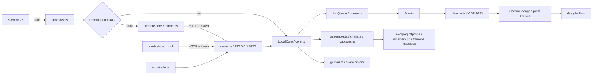

# Audit arsitektur Flow MCP untuk Flow MCP Studio

Audit: 30 Oktober 2026. Basis sumber: `84b548f3aa72b749b82cdbfbb6f91cadebae8642`.
Target produk: aplikasi desktop **Flow MCP Studio** untuk Windows 10/11.
Perubahan audit ini hanya dokumentasi; fungsi utama, manifest, dan lockfile tidak diubah.

## Kesimpulan

Repository menyediakan backend TypeScript/Node.js, server MCP melalui stdio, dan panel web lokal bernama Flow Studio. Ini fondasi yang dapat digunakan kembali, tetapi belum aplikasi desktop mandiri: tidak ada Electron/Tauri, runtime Node terbundel, installer Windows, pembaruan otomatis, atau penandatanganan executable. README sendiri menyatakan Windows belum diuji pada PC nyata. Kelulusan build Linux tidak membuktikan kompatibilitas Windows.

## Struktur dan aliran kontrol

| Komponen | Peran dan batas |
| --- | --- |
| `src/index.ts` | Registrasi 20 tool MCP, anotasi, serialisasi hasil, penanganan panggilan lambat lewat task ID. Versi server `0.2.0`, berbeda dari paket `0.1.0`. |
| `src/core.ts` | Kontrak `Core`, bentuk Zod untuk MCP/HTTP, orkestrasi pekerjaan dan file. Backend bersama bagi MCP dan Studio. Masih menggabungkan banyak tanggung jawab. |
| `src/server.ts` | HTML Studio, health, upload, media dengan Range, dispatch metode `Core`. Hanya bind loopback; memeriksa Host dan token per proses. |
| `src/remote.ts` | Meneruskan metode ke pemilik port yang sama dengan token dari file; memecah penantian panjang. |
| `src/studio.ts` | Menyalakan backend dan membuka browser bawaan; bukan jendela desktop native. Jika backend sudah ada, proses launcher keluar. |
| `src/queue.ts` | Antrean serial, jeda acak 25–70 detik, cancel hanya pekerjaan menunggu, retry terbatas. State berada di memori. |
| `src/chrome.ts` | Mencari executable Chrome, profil terpisah, launch detached, attach Playwright melalui CDP, memaksa UI Flow berbahasa Inggris. |
| `src/flow.ts` | Driver DOM Flow, aset/karakter, generasi, kutipan kredit, retry, unduhan. Bergantung pada struktur halaman dan label Google. |
| `src/assemble.ts`, `src/chain.ts` | Pemrosesan lokal melalui FFmpeg/ffprobe, narasi sistem, ekstraksi frame, mixing dan assembly. |
| `src/captions.ts` | Transkripsi whisper.cpp, model/cache, alignment teks, rendering caption dengan Chrome headless dan FFmpeg. |
| `src/gemini.ts` | TTS melalui API Gemini; membaca key dari environment/file lokal, validasi dan penyimpanan key. Ini akses layanan eksternal meskipun tidak memakai kredit video Flow. |
| `src/platform.ts` | PowerShell, Recycle Bin, pembukaan URL, ekstraksi ZIP dan cabang platform. |
| `studio/index.html` | UI vanilla JS/CSS satu file: Cast, Frames, Shots, Voice, Restyle, Cut, Captions, Library; polling HTTP dan state `localStorage`. |
| `src/techniques.ts`, `src/playbook.ts` | Preset teknik dan panduan penggunaan. |

Pemilik port memegang satu antrean/tab Flow; proses kedua memakai `RemoteCore`. Mekanisme ini mengurangi duplikasi generasi, tetapi bukan lock lintas port/profil. Dua instance dengan port HTTP berbeda dan profil/CDP yang sama masih perlu diuji. Saat port terpakai namun health tidak terkonfirmasi, server cenderung menjadi client; `index.ts` menggunakan core lokal jika role `none`, sedangkan Studio menolak role tersebut. Jangan menganggap semua tabrakan port memiliki perilaku identik.

`LocalCore` baru tidak langsung membuka Flow. Namun JavaScript Studio pada boot memanggil `characters` dan `status`; **membuka UI dapat menjalankan Chrome dan mengakses Google**. Pemeriksaan audit hanya mengambil HTML melalui HTTP, tanpa mengeksekusinya.

## Paket, dependensi, dan build

| Paket | Rentang manifest | Versi lockfile/terpasang | Catatan |
| --- | --- | --- | --- |
| `@modelcontextprotocol/sdk` | `^1.30.0` | `1.30.0` | Transport stdio dan skema tool; memiliki advisori audit. |
| `playwright-core` | `^1.63.0` | `1.63.0` | Tidak mengunduh browser; Chrome perlu tersedia terpisah. |
| `zod` | `^4.6.5` | `4.6.5` | Validasi HTTP/MCP; memiliki advisori audit. |
| `typescript` | `^7.0.2` | `7.0.2` | Compiler dengan paket native opsional per platform. Sertakan optional dependencies dalam instalasi. |
| `@types/node` | `^26.6.2` | `26.6.2` | Tipe lebih baru daripada baseline README Node 22; perlu matriks runtime agar API yang lolos tipe juga tersedia pada baseline. |

`tsconfig.json` memakai ES2022, NodeNext, strict dan `skipLibCheck`; output `dist/`. Tidak ada bundler UI, linter, CI `.github`, `engines`, atau pin runtime/package manager. `main: index.js` tidak sesuai lokasi hasil kompilasi, sementara `bin` menunjuk `dist/index.js`; distribusi sebagai paket perlu menguji entrypoint dan daftar file. Build `tsc` tidak menyalin `studio/index.html`: server membaca `../studio/index.html` relatif terhadap modul dist, sehingga menyalin dist saja merusak Studio.

Skrip yang tersedia: `build`, `start`, `login`, `studio`, dan `test`. Skrip test selalu mengeluarkan `Error: no test specified` lalu exit 1. `scripts/e2e.mjs` adalah pengujian manual yang memanggil `flow_status` dan `flow_generate`; tidak aman untuk audit tanpa akun/biaya. Tidak ada skrip installer, release Windows, atau cross-build desktop.

## Temuan yang perlu diprioritaskan

| ID / prioritas | Bukti dan dampak | Rekomendasi terpisah dari PR dokumentasi |
| --- | --- | --- |
| A1 / P1 | `projectDir` di `core.ts` mempertahankan titik; `projectDir('..')` menghasilkan parent output root. Skema project hanya mewajibkan string tidak kosong. Reproduksi murni tanpa menulis file berhasil. | Tolak `.`/`..`, nama perangkat Windows dan trailing dot/space; cek containment hasil resolusi serta nama file. Tambahkan regression test lintas platform. |
| A2 / P1 | `sendMedia` di `server.ts` mengecek path secara leksikal memakai `resolve`, bukan `realpath`. Request bertoken ke symlink di output root mengembalikan isi file sentinel di luar root. | Validasi canonical path dan symlink/junction; uji output, upload, captions dan operasi file lain. Membutuhkan token dan link yang sudah ada; bukan bukti akses remote tanpa autentikasi. |
| A3 / P1 | `npm audit` exit 1: 8 paket rentan, 3 high dan 5 moderate. | Perbarui dependensi dalam PR tersendiri dan ulangi build/smoke/regresi. Jangan memakai `npm audit fix --force` tanpa penilaian. |
| A4 / P1 | Antrean dan slow-task map hanya di memori; proses mati kehilangan hasil/status. Beberapa operasi Flow (edit/continue) tidak memiliki kutipan kredit sebelum berjalan. | Persist job journal, rekonsiliasi setelah crash, dan konfirmasi pengeluaran eksplisit. Jangan mengulang otomatis pekerjaan berbayar yang statusnya belum jelas. |
| A5 / P2 | Profil Chrome berisi sesi login; Gemini key berupa file teks. Mode POSIX `0600` bukan bukti ACL privat di Windows. Token media juga boleh berada dalam query URL. | Gunakan ACL per pengguna/penyimpanan key OS, redaksi log dan pembatasan URL token. Tinjau CSP/Origin dan navigasi sebelum UI mendapat hak desktop. |
| A6 / P2 | Download berpindah melalui `renameSync` dari direktori home ke output yang bisa dikonfigurasi pada volume berbeda. | Tangani `EXDEV` dengan copy-verify-remove serta file terkunci/antivirus. Uji tanpa akun memakai fixture. |
| A7 / P2 | Unduhan model caption memeriksa ukuran minimum, tanpa checksum terpin. | Verifikasi hash dari sumber tepercaya; pertahankan verifikasi TLS. |
| A8 / P2 | `captionSetup.ready` terutama memeriksa keberadaan whisper; bukan bukti Chrome, FFmpeg, model dan codec siap. | Pemeriksaan kapabilitas terpisah dengan pesan per prasyarat. |

Hasil advisori saat audit: `@modelcontextprotocol/sdk` (high), `zod` (high), `body-parser` (high), `@hono/node-server`, `fast-uri`, `hono`, `ip-address`, `qs` (moderate). Contoh referensi: [SDK](https://github.com/advisories/GHSA-f897-62hf-6gxq), [Zod](https://github.com/advisories/GHSA-mrhx-c7xc-m3w5), [body-parser](https://github.com/advisories/GHSA-27r3-jxmh-p828). Jumlah tersebut menghitung paket, bukan jumlah advisori. Banyak advisori SDK berkaitan dengan HTTP/OAuth; aplikasi ini memakai MCP stdio dan HTTP Node sendiri. Temuan versi tidak otomatis membuktikan seluruh jalur rentan dapat dieksploitasi pada aplikasi ini.

## Bukti validasi Codex Cloud

Mesin Linux; Node `24.19.0`, npm `11.9.0`, FFmpeg `7.1.5`. Pemeriksaan dilakukan tanpa login Google, key Gemini, generasi gambar/video, atau pemakaian kredit.

| Pemeriksaan | Hasil |
| --- | --- |
| `npm ci --include=dev --include=optional --no-audit --no-fund` | Lulus, 99 paket dipasang; lockfile tetap. |
| `npm run build` | Lulus, TypeScript terkompilasi. Percobaan awal gagal karena instalasi sebelumnya belum lengkap; setelah instalasi ulang lulus. |
| `npm test` | Gagal exit 1 sesuai placeholder; tidak ada test suite yang berjalan. |
| `npm audit --json` | Selesai exit 1 karena 8 paket rentan; bukan kegagalan koneksi registry. |
| Smoke lokal | 10 pemeriksaan lulus: fake queue/cancel/serial, skema cap negatif, caption alignment, assembly dua klip sintetis menjadi video ~2 detik dengan audio, ekstraksi frame, startup/HTML Studio, penolakan token/Host, API techniques, penolakan scenes kosong, MCP initialize/list/call melalui RemoteCore. |
| Reproduksi temuan | A1 dan A2 terkonfirmasi memakai data sementara; tidak menyentuh file pengguna. |
| Google Flow E2E, browser UI aktual, TTS Gemini | Tidak dijalankan sesuai batas audit. |
| Windows native, installer, whisper dan caption render lengkap | Tidak dijalankan; prasyarat/runner belum tersedia. |

Harness audit disimpan **di luar checkout**, `/workspace/flow-mcp-audit/smoke.mjs`, untuk pengulangan di snapshot environment ini. Ia bukan suite repository dan tidak ikut PR. Jalankan setelah build: `node /workspace/flow-mcp-audit/smoke.mjs`; memerlukan FFmpeg/ffprobe serta izin subprocess/loopback. Harness membersihkan data sementara dan menghentikan prosesnya. Untuk pengulangan pada checkout lain, buat test suite permanen pada tahap roadmap; jangan menganggap helper tersebut ikut terdistribusi bersama Git.

Instalasi jaringan/subprocess sempat ditolak sandbox; eskalasi eksekusi yang didukung menyelesaikan instalasi dan smoke lokal dengan proxy/TLS tetap aktif. Itu masalah batas executor, bukan bukti bug aplikasi. Pengujian Host memakai `node:http.request` agar header Host benar-benar terkirim; percobaan awal `fetch` tidak menjadi bukti kegagalan server.

## Batas keamanan produk desktop

Pertahankan Chrome Google login sebagai browser eksternal dengan profil khusus; jangan memindahkan login ke renderer desktop pada tahap awal. Jika Electron dipilih, gunakan renderer tanpa Node integration, context isolation, sandbox, preload minimal dan allowlist IPC. Blok navigasi eksternal tak terduga dan buka tautan eksternal secara tervalidasi. Jangan mengekspos CDP/HTTP ke jaringan atau menambahkan kemampuan melewati deteksi bot. Klaim biaya/kuota dalam README bukan kontrak layanan yang diverifikasi audit ini.
